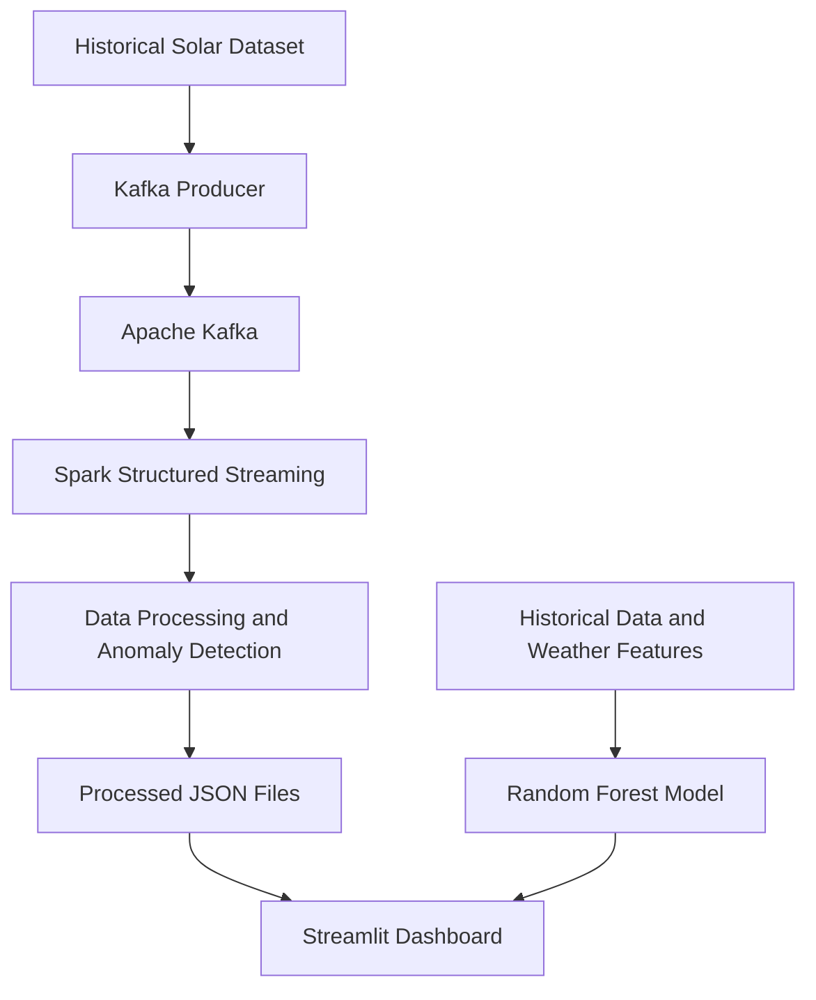

# SolarSense — Intelligent Solar Forecasting & Monitoring

An IoT-inspired solar power monitoring system combining machine learning, stream processing, and interactive visualization to analyze solar generation and detect low-generation anomalies.

## Overview

SolarSense demonstrates how solar generation data and weather conditions can support solar plant monitoring and energy-management decisions.

The system combines a Random Forest regression model for solar power forecasting with a Kafka–Spark pipeline for processing incoming readings and detecting potential generation anomalies.

### Key Features

- Solar power generation analysis using historical data.
- Random Forest regression for next-interval power forecasting.
- Kafka-based streaming of solar readings.
- Spark Structured Streaming for data processing and anomaly detection.
- Interactive Streamlit dashboard.
- Anomaly filtering and processed-data CSV export.

> **Note:** Historical dataset records are replayed through Kafka to simulate real-time streaming. This project does not currently represent a physical IoT deployment.

## Architecture



## Technology Stack

| Technology | Purpose |
|---|---|
| Python | Application development |
| Pandas | Data preparation and analysis |
| Scikit-learn | Random Forest regression |
| Apache Kafka | Streaming solar readings |
| Apache Spark | Stream processing and anomaly detection |
| Streamlit | Interactive dashboard |
| Docker Compose | Kafka and Kafka UI services |
| Jupyter Notebook | Data analysis and model development |

## Machine Learning Model

The trained `RandomForestRegressor` estimates AC power generation for the next 15-minute interval.

- **Target:** Next-interval plant AC power
- **Features:** Historical AC power, weather measurements, and time-related features
- **Train/test split:** Chronological 80/20 split

### Baseline Evaluation Results

| Metric | Result |
|---|---:|
| R² Score | 0.9303 |
| Mean Absolute Error (MAE) | 1043.66 |
| Root Mean Squared Error (RMSE) | 2102.42 |

These are historical test-set results, not guarantees of live forecasting accuracy.

Saved model: `models/solar_forecast_model.pkl`

## Anomaly Detection

Spark processes incoming readings using configured anomaly-detection rules.

| Field | Description |
|---|---|
| `DATA_QUALITY_ISSUE` | Indicates a data-quality issue |
| `ZERO_GENERATION_ANOMALY` | Identifies a configured zero-generation anomaly |
| `EXPECTED_MIN_AC_POWER` | Configured minimum expected power threshold |
| `LOW_GENERATION_ANOMALY` | Flags generation below the applicable threshold |

Anomaly flags indicate readings that may require investigation; they do not independently establish equipment failure.

## Dashboard

The Streamlit dashboard includes:
- Generation summary metrics.
- Solar generation and environmental charts.
- Low-generation anomaly filters.
- Historical and test/recent reading views.
- Processed readings table.
- CSV export.

Forecast visualizations depend on the forecasting functionality implemented in the dashboard.

## Project Structure

```text
SolarSense/
├── dashboard/
│   └── app.py
├── evaluation/
│   └── test_evaluation_predictions.csv
├── kafka/
│   └── solar_producer.py
├── models/
│   ├── solar_forecast_model.pkl
│   └── solar_anomaly_thresholds.json
├── notebook/
│   └── Solar_Data_Analysis.ipynb
├── spark/
│   ├── evaluate_anomalies.py
│   ├── generate_thresholds.py
│   ├── solar_consumer.py
│   └── requirements.txt
├── docker-compose.yml
├── requirements.txt
└── README.md
```

Raw datasets and generated Spark output are excluded from Git.

## Prerequisites

- Python and a virtual environment.
- Docker Engine and Docker Compose.
- Apache Spark with the required Kafka connector.
- The solar generation dataset used during development.

## Setup

### 1. Clone the Repository

```bash
git clone https://github.com/RS-8105/SolarSense-Intelligent-Solar-Forecasting-Monitoring.git
cd SolarSense-Intelligent-Solar-Forecasting-Monitoring
```

### 2. Create and Activate a Virtual Environment

```bash
python3 -m venv .venv
source .venv/bin/activate
```

### 3. Install Dependencies

```bash
pip install -r requirements.txt
pip install -r spark/requirements.txt
```

### 4. Prepare the Dataset

Place the required generation and weather CSV files in:

```text
data/raw/Solar Power Generation/
```

The dataset is not included in this repository. Ensure the filenames and columns match the expectations in the notebook and producer code.

### 5. Start Kafka and Kafka UI

```bash
docker compose up -d
```

- Kafka UI: http://localhost:8080
- Kafka bootstrap address: `localhost:9092`

Kafka data persistence is configured using a named Docker volume.

### 6. Start the Spark Consumer

Run in a separate terminal:

```bash
source .venv/bin/activate

spark-submit \
  --packages org.apache.spark:spark-sql-kafka-0-10_2.13:4.2.0 \
  spark/solar_consumer.py
```

Keep Spark running while sending readings.

The Spark UI is usually available at http://localhost:4040 while the application is active. The port may differ if occupied.

### 7. Start the Kafka Producer

Run in another terminal:

```bash
source .venv/bin/activate
python kafka/solar_producer.py
```

The producer replays historical readings through Kafka to simulate streaming input.

### 8. Launch the Dashboard

Run in another terminal:

```bash
source .venv/bin/activate
streamlit run dashboard/app.py --server.port 8502
```

Open http://localhost:8502.

The dashboard reads processed data from `data/processed/solar_readings/`. Keep the Spark consumer running so new readings can be processed.

## Demo Workflow

1. Start Kafka and Kafka UI.
2. Start the Spark streaming consumer.
3. Run the Kafka producer or send a test reading to Kafka.
4. Verify incoming messages in Kafka UI.
5. Inspect Spark's processed output and anomaly flags.
6. Open the Streamlit dashboard and examine the readings.

A test reading with low AC power and sufficiently high irradiation can demonstrate the anomaly-detection rules. The result depends on the configured thresholds and conditions.

## Limitations

- Historical readings simulate real-time streaming; physical sensors are not connected in this setup.
- Forecast quality depends on the training data and weather conditions.
- Sudden generation changes may be difficult to predict.
- Anomaly flags require further investigation.
- Historical evaluation metrics do not guarantee live performance.

## Future Enhancements

- Integration with physical IoT sensors.
- Weather forecast API integration.
- Improved short-term and day-ahead forecasting.
- Alerts for persistent low-generation anomalies.
- Forecast-versus-actual monitoring.
- Cloud deployment.

## Author

**Rushikesh Somani**  
Computer Engineering Student

## License

No license has been specified yet. Add a license before allowing others to reuse, modify, or redistribute the project under explicit terms.

---

*SolarSense — Turning solar generation data into actionable insights.*
